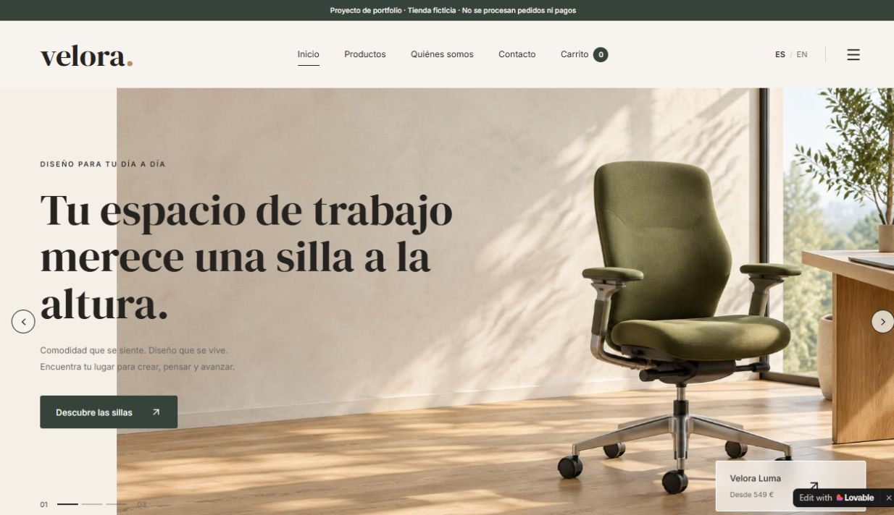
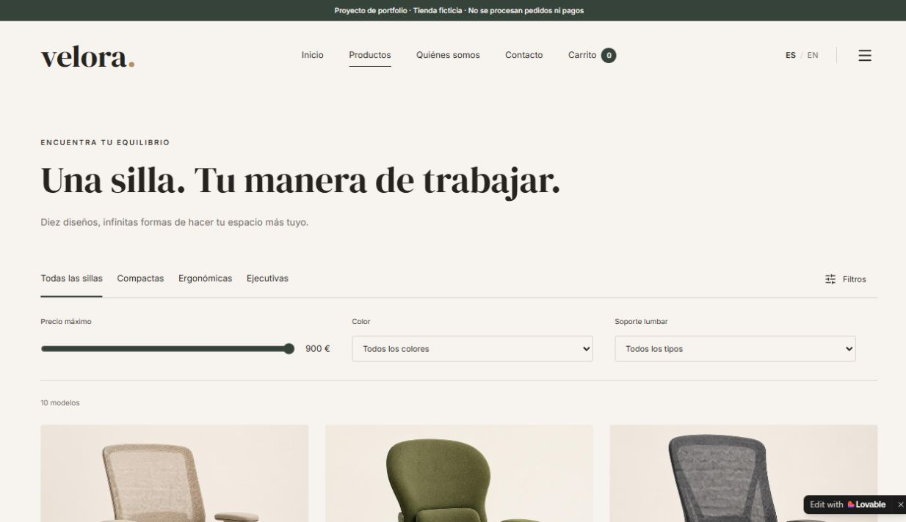
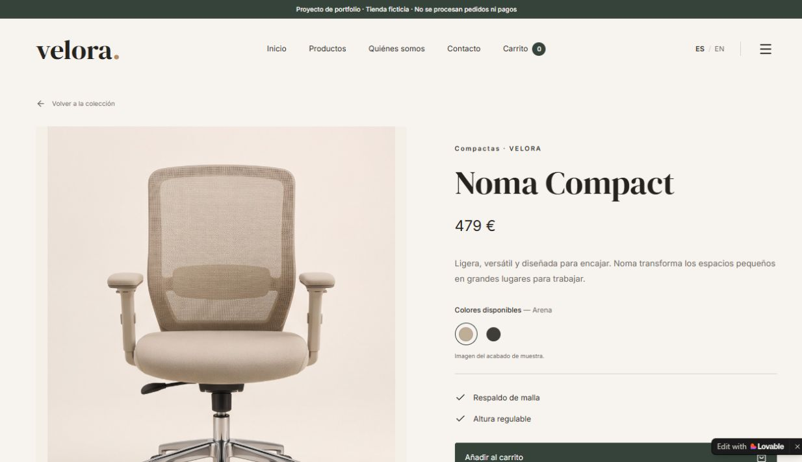
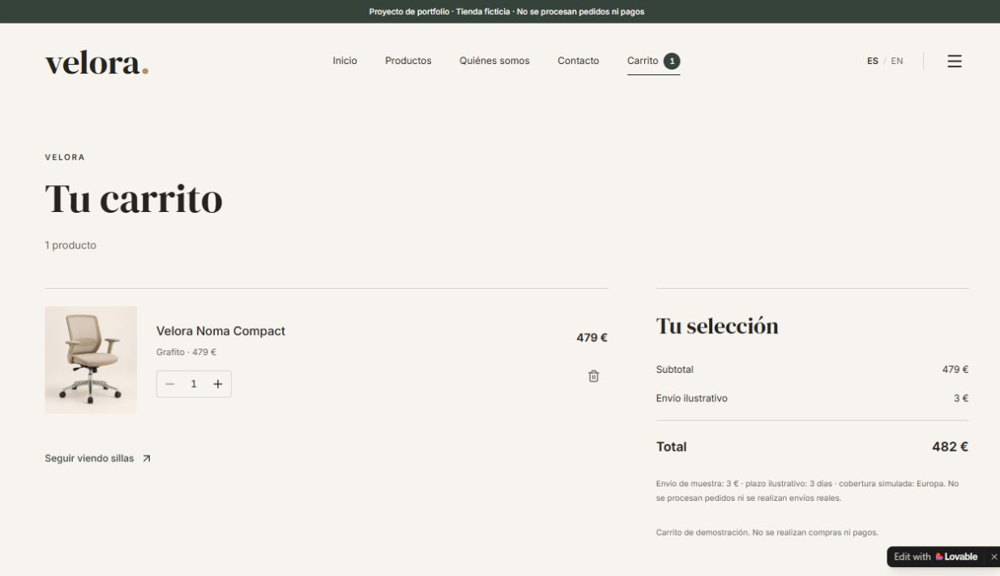

# Velora Chairs

**Una tienda de sillas de oficina creada con Lovable**

Soy Unai. En este proyecto he desarrollado con Lovable una tienda ficticia de sillas de oficina. Presento una experiencia en la que se puede explorar un catálogo, consultar un producto, elegir una variante y probar un carrito de demostración.

**[Abrir la demo](https://velora-chairs.lovable.app/) · [Recorrer el proyecto](docs/recorrido.md) · [Ver las comprobaciones](docs/verificacion.md)**

> Proyecto personal de portfolio. La marca, los productos, los precios y los datos comerciales pertenecen a una demostración. No se procesan pedidos, pagos ni envíos reales.

## El objetivo

Mi objetivo es representar el recorrido de una persona que busca una silla de oficina: descubrir las opciones, comparar sus características y preparar una selección. El resultado permite mostrar esa experiencia en el navegador, sin necesidad de instalar nada.

## Qué he construido

| Parte del proyecto | Qué puedes explorar |
| --- | --- |
| Inicio | Presentación de la marca y acceso a los productos. |
| Catálogo | Diez modelos agrupados en sillas compactas, ergonómicas y ejecutivas. Incluye controles de precio, color y soporte lumbar. |
| Ficha de producto | Imágenes, descripción, precio, características y selector de color. |
| Carrito de demostración | Añadir un producto, modificar su cantidad, eliminarlo y consultar el total ilustrativo. |
| Idiomas y contacto | Selector español/inglés y página de contacto con un formulario de muestra. |

## Mi trabajo y la herramienta utilizada

He utilizado **Lovable**, una herramienta de creación de aplicaciones mediante instrucciones en lenguaje natural y asistencia de IA. En este portfolio presento el resultado como un proyecto de creación web asistida por IA.

La muestra permite valorar cómo organizo una experiencia de catálogo, presento información de producto y explico el alcance de una solución digital. El uso de Lovable forma parte del trabajo y se identifica de manera expresa.

## Una vista del recorrido

| Catálogo | Ficha de producto |
| --- | --- |
|  |  |

*Capturas de la demo publicadas como evidencia visual del proyecto. Puedes abrirlas para verlas a mayor tamaño.*

## Qué funciona y qué está simulado

He comprobado el filtro de categoría, el cambio de vista de una galería, la selección de una variante, las operaciones del carrito y el cambio de idioma en la página de contacto. El detalle está en el [registro de comprobaciones](docs/verificacion.md).

El carrito calcula importes de ejemplo. El formulario indica que no envía datos. La selección de color identifica la variante elegida; las imágenes muestran un acabado de muestra y no representan necesariamente cada color.

No presento este ejercicio como una tienda en explotación ni como un encargo para un cliente real. No atribuyo al proyecto ventas, mejora de conversión ni ahorros medidos.

## Documentación

- [El proyecto explicado](docs/proyecto.md): objetivo, estructura y decisiones visibles de la experiencia.
- [Recorrido de la demo](docs/recorrido.md): guía para explorar el proyecto paso a paso.
- [Comprobaciones y límites](docs/verificacion.md): acciones revisadas, resultados observados y aspectos pendientes.

Este repositorio contiene la presentación del caso, su documentación y capturas. La aplicación se consulta en la demo alojada en Lovable; su código fuente no está incluido en este repositorio.

**Autor: Unai · Revisión de la demo: 20 de octubre de 2026.**
